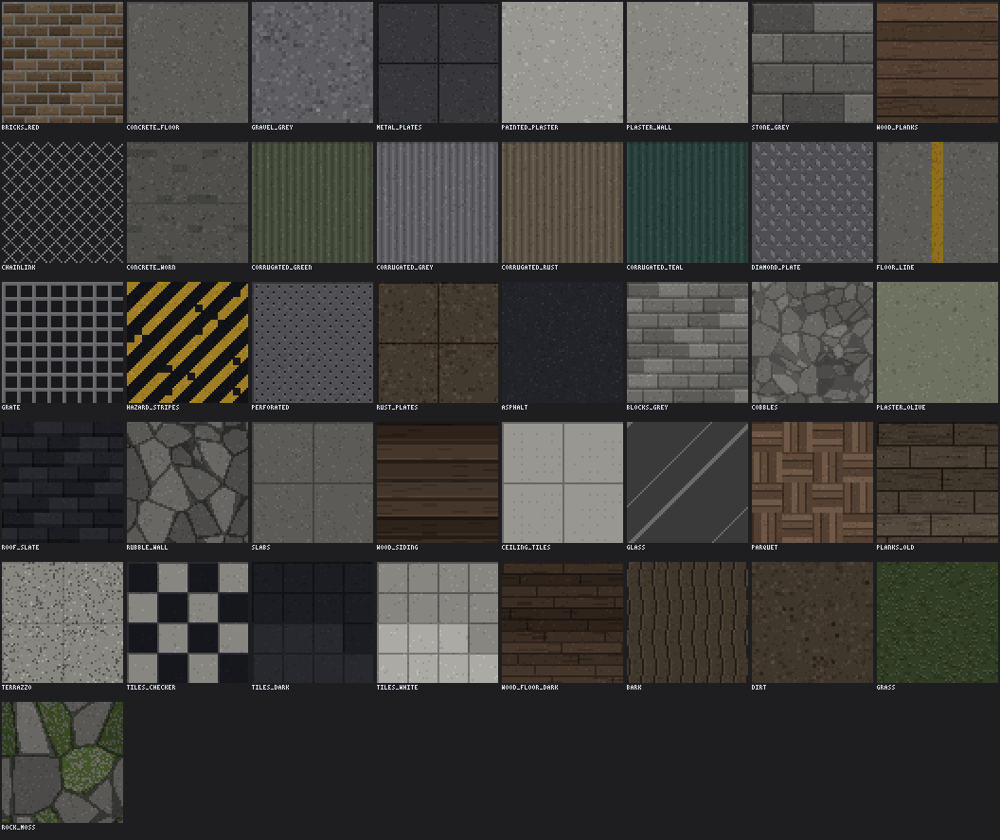
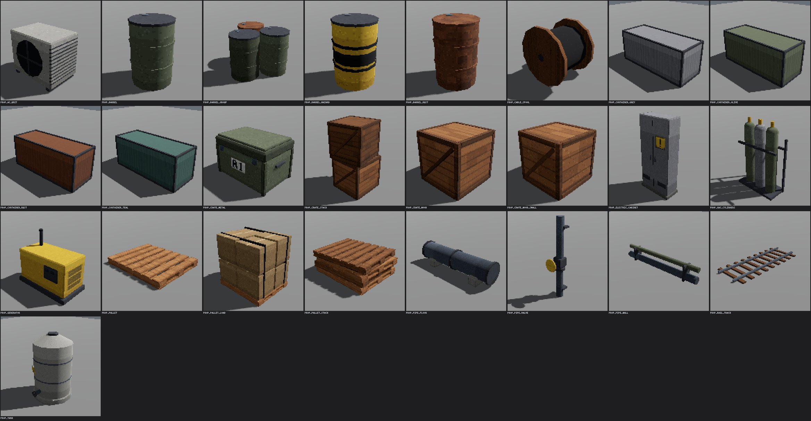
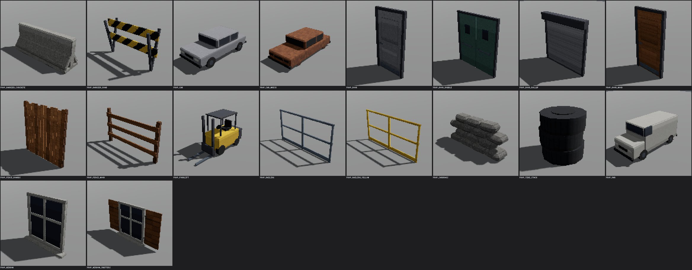
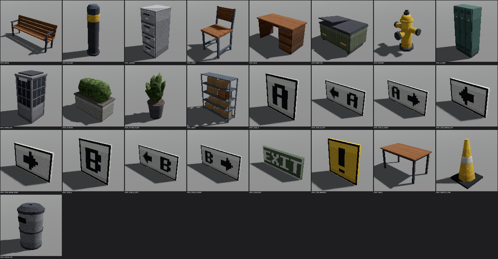
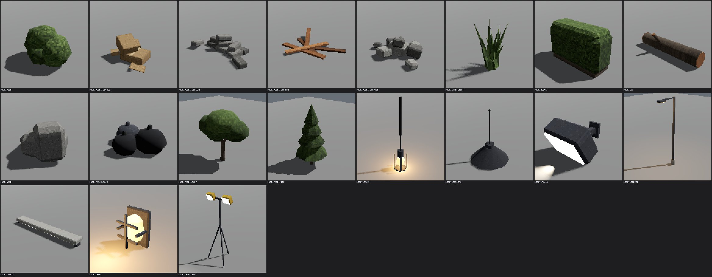
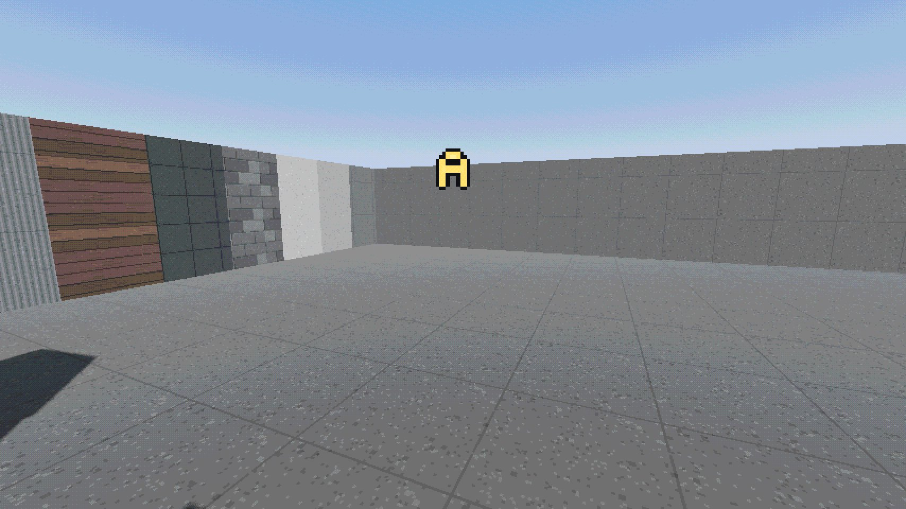

# Chiip — Mapping guide

> Last updated: 2026-10-16
>
> How to build a map for Chiip from the map kit (M10): the workflow in TrenchBroom, the rules a map follows, every texture set, prop, lamp and entity with a picture, the limits, and a checklist before you share a map. Decisions D-121 to D-129 (provisional until your playtest).

## What the kit is

The kit is everything you need to make a whole map in **TrenchBroom** without touching Godot's editor:

| Part | What it is | Where |
|---|---|---|
| Textures | 41 pixel textures drawn like the crew (D-140), in five sets: the base set (8) and `industrial`, `urban`, `interior`, `nature` | `assets/textures/` |
| Props | 80 props in ten categories (crates, containers, fences, doors, signs, cars, trees...) | `maps/kit/props/` |
| Lamps | 7 lamps that are real lights | `maps/kit/lights/` |
| Brush entities | See-through glass and fences, invisible clip walls, bomb sites, and func_godot's detail and illusionary brushes | `maps/fgd/` |
| Gameplay entities | Spawns, respawn, patrol and hold points, attack routes | `maps/fgd/` |
| A gallery map | Everything above in one playable yard | `maps/kit/kit_gallery.tscn` |
| A map template | The scene a new map is made from: sky, sun, player, navigation | `maps/kit/map_template.tscn` |

You draw the map in TrenchBroom and save a `.map` file. One command turns it into a playable Godot scene. After that, every edit is "save, build, bake, test".

- The rules the three quick maps follow (and your map should too) are in [MAPS.md](MAPS.md).
- To see the whole kit first, play the gallery: `/Applications/Godot.app/Contents/MacOS/Godot --path . -- --map res://maps/kit/kit_gallery.tscn`
- The decisions behind the kit are in [DECISIONS.md](DECISIONS.md) (D-121 to D-129). How it is built is in [ARCHITECTURE.md](ARCHITECTURE.md), "TrenchBroom maps".

Run every command in this guide from the project folder (the one with `project.godot`). On a fresh checkout, run the import once first, so Godot knows the kit's scripts:

```bash
/Applications/Godot.app/Contents/MacOS/Godot --headless --path . --import
```

## Your first map, step by step

### Words you will meet

| Word | Meaning | Unity comparison |
|---|---|---|
| Brush | A solid block with flat sides: the walls, floors and ramps you draw in TrenchBroom. It is convex (no dents). | A ProBuilder cube |
| Face | One side of a brush. Each face has its own texture. | A material slot on one side |
| Entity | A thing in the map with a *classname* and properties: a spawn, a lamp, a crate. A **point entity** sits at one point; a **brush entity** is made of brushes (glass, a bomb site). | A GameObject with components |
| Worldspawn | All brushes that are not inside an entity: your plain walls and floors. | The static level geometry |
| Entity browser, texture browser | TrenchBroom's lists of every entity and texture the game offers. | The Project window |
| FGD | The file that tells TrenchBroom which entities exist. Godot writes it from the kit. | — |
| func_godot | The Godot addon that builds a `.map` into Godot nodes. | An asset importer |
| Scene (`.tscn`) | Godot's saved level or prefab. Your map becomes one. | A Unity scene or prefab |
| Navmesh | The walkable surface the bots use. You bake it from your geometry. | A baked NavMesh |

### 1. Set up TrenchBroom

Follow "Making maps with TrenchBroom" in the [README](../README.md#making-maps-with-trenchbroom): install TrenchBroom, install Chiip's game configuration, and set Chiip's *Game Path* to the project folder in TrenchBroom's Preferences. Without the game path, faces show placeholder textures.

The configuration holds the entity list. **After the kit changes** (a new prop or lamp, a changed description), refresh it:

```bash
/Applications/Godot.app/Contents/MacOS/Godot --headless --path . --quit-after 100 --script res://tools/export_trenchbroom_config.gd -- "$HOME/Library/Application Support/TrenchBroom/games/Chiip"
```

Then restart TrenchBroom: it reads the game configuration when it starts.

### 2. Start a map

1. In TrenchBroom: *File → New*. Pick the game **Chiip** and the map format **Valve**.
2. Save at once with *File → Save As*, as `maps/<name>.map` inside the project folder (for example `maps/my_map.map`). Put it directly in `maps/` and the map shows up by itself in the match setup's map list and in the console's `map` command.
3. Pick your own name. Don't copy Counter-Strike's map names or layouts (D-031).

### 3. Draw the floor and walls

Everything you draw is made of brushes. Draw a box on the grid in the top view, then set its height in a side view. Some numbers to start from (the gallery uses them):

- Floor: top face at height 0, about 0.4 m (16 units) thick. Entities you place at height 0 then stand on the floor.
- Outer walls: 4 m (157 units) high, 0.5 m (20 units) thick.
- Plan for 40–60 m across with three lanes (see "Building rules and timing" below). The three quick maps are 46–48 m wide and 56 m long.

Leave doorways and gaps **at least 2.5 m (98 units) wide and 3 m (118 units) tall**: bots are 1 m wide on the navmesh and need the room. Never build steps; use ramps (the rules are below).

TrenchBroom's own manual explains its tools, shortcuts and grid: https://trenchbroom.github.io/manual/latest/ (*Help → TrenchBroom Manual* in the app).

### 4. Apply textures

Select a brush (or some of its faces), then click a texture in the texture browser. The browser shows the base set at the top and one collection per set (`industrial`, `urban`, `interior`, `nature`). A 64-pixel texture covers 64 units (1.63 m). The textures are listed with pictures in "Textures" below.

Start with **at most six main materials** for the big surfaces and use others only in small doses (see "Look rules").

### 5. Place props, lamps and markers

Open the entity browser. Props are named `prop_...`, lamps `light_...`, gameplay markers `info_...`. Pick one and place it in the map. TrenchBroom shows the real model of every prop and lamp.

- Turn an entity by setting its **angle** property (degrees). Angle 0 points the entity's front along TrenchBroom's +X. See "Units, axes and origins".
- A floor prop stands on its origin: place it at the floor's height.
- A wall prop needs its origin **on the wall face**. A ceiling lamp needs it on the ceiling.
- Markers the game needs: 5 attack spawns, 5 defend spawns, 2 bomb sites, 3 routes, hold, respawn and patrol points. See "Gameplay entities".

### 6. Save, then make the scene (once)

Save in TrenchBroom (⌘S), then run:

```bash
/Applications/Godot.app/Contents/MacOS/Godot --headless --path . --quit-after 3000 --script res://tools/new_map.gd -- res://maps/my_map.map
```

This writes `maps/my_map.tscn` (from the map template) and `maps/my_map_navmesh.tres`, builds the map into the scene and bakes the navmesh. It never overwrites an existing scene. You can run it before the map is finished: it only makes the scene. From then on use the build and bake commands in "After an edit".

### 7. Play it

```bash
/Applications/Godot.app/Contents/MacOS/Godot --path . -- --map res://maps/my_map.tscn
```

It starts a match on your map. With bomb sites the rounds are bomb rounds; without, plain elimination. In the game's console, `map my_map` loads it too.

### 8. Check it

Play bot rounds on it (headless, takes a minute or two; the exit code is the number of failed checks):

```bash
/Applications/Godot.app/Contents/MacOS/Godot --headless --path . --fixed-fps 128 --quit-after 400000 res://tests/maps_test.tscn -- --map res://maps/my_map.tscn
```

Measure its size, walking distances and sightlines:

```bash
/Applications/Godot.app/Contents/MacOS/Godot --headless --path . --quit-after 20000 --script res://tools/map_report.gd -- res://maps/my_map.tscn
```

What the maps test checks on your map:

| Check | Needs |
|---|---|
| Markers | A `Player` (the template has one), 5 defend spawns, 5 attack spawns, 3 routes of at least 3 points, at least 5 hold spots, 2 bomb sites, at least 8 respawn points and at least 8 patrol points |
| Navmesh | Every marker within 0.8 m of the navmesh and within 1 m of its height |
| Paths | Both spawns can walk to both bomb sites |
| First contact | The median of 4 seeded bot rounds is 5–10 s after the round goes live |
| Rounds | Rounds are decided by fighting or the bomb, not by the clock |
| Team respawn | A bots-only respawn match to 20 kills ends within 3 minutes, and the kills spread over the map |

`tools/map_report.gd` prints the walkable size, the walk from spawn to spawn, to each site and along each route, the longest sightlines and the number of spawn-to-spawn views. Targets are in "Building rules and timing".

## After an edit

`new_map.gd` runs **once**. When you change the `.map` afterwards, only rebuild. The scene keeps whatever you changed in it by hand (the sky, the sun). In this order:

1. Save the `.map` in TrenchBroom.
2. Build it into the scene (or select the `Map` node in Godot and click **Build Map**, then save):

   ```bash
   /Applications/Godot.app/Contents/MacOS/Godot --headless --path . --quit-after 500 --script res://tools/build_maps.gd -- res://maps/my_map.tscn
   ```

3. Bake the navmesh (do it whenever walls, floors or solid props moved):

   ```bash
   /Applications/Godot.app/Contents/MacOS/Godot --headless --path . --quit-after 500 --script res://tools/bake_navmesh.gd -- res://maps/my_map.tscn
   ```

4. Run the maps test and the map report from step 8 above. If you moved floor or walls, move any marker that now stands inside them.
5. Take screenshots through the real game (opens a window briefly, never touches the mouse). Characters are hidden, so you see the map alone:

   ```bash
   /Applications/Godot.app/Contents/MacOS/Godot --path . --resolution 1280x720 --quit-after 3000 --script res://tools/map_screenshots.gd -- --map res://maps/my_map.tscn --out <folder>
   ```

   It saves an overview, both spawns, both sites and the middle of the lanes.

Add `--lighting ssao` or `--lighting sdfgi` to the screenshot command only to compare lighting (D-085). Chiip doesn't use either.

## Units, axes and origins

| Thing | Value |
|---|---|
| Unit | 1 TrenchBroom unit = 1 inch = 2.54 cm. 39.37 units = 1 m. |
| Player | 72 units tall (1.83 m), 54 crouched. Eyes at 64 units (1.63 m). |
| Jump | Clears 57 units (1.45 m). A crouch-jump clears 75. |
| Standard crate | 64 units (1.63 m) |
| Texture | 64 pixels cover 64 units |
| Walk speed | 5.5 m/s with a rifle in hand |

Handy conversions: 1.2 m = 47 units, 2.2 m = 87, 2.5 m = 98, 3 m = 118, 4 m = 157.

**Axes.** TrenchBroom and Godot name them differently. TrenchBroom's X is Godot's z, TrenchBroom's Y is Godot's x, and up (Z) stays up. In TrenchBroom's top view the quick maps read like this: **north (the defenders' end) is on the left, east is at the top.** South (the attackers' end) is on the right.

**Angle.** An entity's `angle` is the way its front points, in degrees. The front is the side the model faces: a car's nose, a door's outer side, the direction a spawn or hold spot looks.

| Angle | TrenchBroom direction | On the quick maps' compass |
|---|---|---|
| 0 | +X | south (toward the attackers' end) |
| 90 | +Y | east |
| 180 | −X | north (toward the defenders' end) |
| 270 | −Y | west |

So defenders at the north end face south (angle 0) and attackers at the south end face north (angle 180). The kit gallery is built this way.

**Origins.** The origin is the point TrenchBroom shows as the entity's position.

| Kind | Origin | Examples |
|---|---|---|
| Floor props | On the floor, in the middle of the prop | crates, barrels, containers, cars, trees |
| Wall props at the floor | On the wall face, at the floor | doors, `prop_pipe_wall`, `prop_pipe_valve` |
| Wall props at their middle | On the wall face, at the middle of the prop | windows, signs, `light_wall`, `light_flood` |
| Ceiling lamps | On the ceiling; the lamp hangs below | `light_cage`, `light_ceiling`, `light_strip` |
| Markers (`info_*`) | At the floor, the player's feet | spawns, holds, respawns |

For a wall prop, set the angle to the direction from the wall **into the room**. A prop on the room's east wall faces west, so its angle is 270.

## Look rules

Full list with measurements: [MAPS.md](MAPS.md), "Look rules" (D-063, D-031). In short:

- **Minimal and readable.** Calm base surfaces, clean spaces, details in small doses. Chiip looks like a 1990s shooter, not like a realistic game.
- **At most 6 main materials** for the big surfaces: floors, walls, roofs, large blocks. Variants of one material count once: the same ribbed metal in four colours, pale and olive plaster, cobbles and slabs. Add **details** on top in small doses: trims, edges, signs, props and lamps (D-127). Dressed Depot uses six (gravel, concrete, blocks, plaster, ribbed metal, wood), Square five.
- **No saturated red or blue on surfaces.** Characters wear the team colours (your team blue, enemies red, D-042), so they must stand out. Walls, floors and big props are neutral greys, with wood as the warm accent. Muted greens and ochres are fine. Safety yellow only on small parts.
- **Neutral shadows.** Use an environment with a grey ambient light, not the blue sky's (see "Sky, sun and lighting").
- **Cool daylight.** A neutral white sun and a grey-blue sky. Warm light comes only from lamps.
- **No desert or dust look** (D-031). Chiip stays visually distinct from Counter-Strike.

**Check a texture** by numbers, not by eye. The report counts the pixels that look like a team colour (at most 3 %) and the average saturation (at most 0.45). It prints a verdict for each texture and its exit code is the number of failing ones:

```bash
/Applications/Godot.app/Contents/MacOS/Godot --headless --path . --quit-after 100 --script res://tools/texture_report.gd -- res://assets/textures/industrial [more folders or PNGs] [--sheet <scratchpad>/sheet.png]
```

`--sheet` also writes a labelled contact sheet of the textures, like the picture in "Textures".

## Building rules and timing

What the characters and the bots can handle (from [MAPS.md](MAPS.md), D-060):

| Rule | Value | In units |
|---|---|---|
| Steps | **None.** Characters don't climb steps. Every height change is a ramp. | |
| Ramps | 26° or less (the navmesh allows 46°). A 1.5 m rise needs a run of at least 3.1 m. | |
| Doors and gaps | At least 2.5 m wide and 3 m tall (bots are 1 m wide on the navmesh) | 98 × 118 |
| Low cover | 1.2 m or less: you can shoot over it and jump onto it | 47 |
| Tall cover | 2.2 m or more: it hides a standing player | 87 |
| Raised floors | A 1.5 m terrace adds 1.5 m to your eye height, so the walls it overlooks must be taller. Spillway's channel fences are 3 m for that reason. | |
| Bomb sites | The centre of each site is open floor (a plant spot), not a crate | |

**Timing** (D-049, D-061). These keep a round moving:

| Target | Value |
|---|---|
| Size | 40–60 m across |
| Lanes | Three (west, mid, east), each with its own character, plus connectors |
| First contact | 5–10 s after the round goes live (median of 4 bot rounds), measured by the maps test |
| Longest sightlines | About 40 m or less |
| Spawn-to-spawn views | None. No spot sees the other spawn. |
| Spawns | 5 per side, 3 m apart. The quick maps put them 49–51 m apart. |
| Bomb sites | A in the west half, B in the east half, both in the defenders' half |

Measure with the maps test (first contact) and the map report (distances and sightlines); the commands are in step 8 above. A walk of 52 m takes about 9.5 s, but contact comes earlier because defenders move up to their hold spots and toward the sound of footsteps. The report counts spot pairs that see each other over 25, 30 and 40 m; the quick maps have between 0 and 3 pairs over 40 m (see the measurements in [MAPS.md](MAPS.md)).

## Textures

TrenchBroom lists every image below `assets/textures/` and turns each folder into a collection (D-121). A face's texture name is its path without the extension, for example `industrial/rust_plates`. All textures are 64 × 64 and cover 1.63 m. They are **drawn by `tools/make_world_textures.py` the way the crew is painted** (D-140): a flat base shade from the crew's 16-shade palette, a simple pixel pattern for what the surface is (boards, blocks, stones, panels, tiles, ribs, gravel) with one-texel joints, and very little grain. So the world and the players look like one game.



*Left to right, top to bottom: the base set (the first eight), then `industrial`, `urban`, `interior`, `nature`.*

**Sounds.** Footsteps and bullet impacts sound like the floor. The kind comes from the texture's *file name* (the folder doesn't matter): a name with `metal`, `steel`, `iron`, `plate`, `grate`, `rust`, `corrugated`, `perforated` or `chainlink` is **metal**; `wood`, `plank`, `parquet`, `siding` or `bark` is **wood**; `gravel`, `dirt`, `grass`, `ground`, `mud` or `sand` is **gravel-like** ground. Everything else (concrete, stone, plaster, tiles) is **hard**. Only plain brushes (worldspawn) remember their textures: a floor inside `func_detail` always sounds hard.

### Base set

| Texture | What it looks like | Sound |
|---|---|---|
| `concrete_floor` | Plain mid-grey concrete with one slab joint per tile. Floors, docks, channel walls. | hard |
| `plaster_wall` | Smooth light plaster | hard |
| `painted_plaster` | Smooth pale painted plaster | hard |
| `stone_grey` | Grey stone blocks in courses (pillars, corner houses) | hard |
| `gravel_grey` | Fine grey gravel | gravel |
| `metal_plates` | Dark grey riveted panels | metal |
| `wood_planks` | Brown horizontal boards: the warm accent (crates, stacks) | wood |
| `bricks_red` | Muted brown bricks with light mortar. It passes the look rules now, but the quick maps don't use it. | hard |

### `industrial/`

| Texture | What it looks like | Sound |
|---|---|---|
| `industrial/chainlink` | Diamond wire lattice with see-through holes. For `func_fence`. | metal |
| `industrial/concrete_worn` | Concrete with formwork seams and tie holes | hard |
| `industrial/corrugated_green` | Olive ribbed sheet metal | metal |
| `industrial/corrugated_grey` | Grey ribbed sheet metal | metal |
| `industrial/corrugated_rust` | Rusty brown ribbed sheet metal | metal |
| `industrial/corrugated_teal` | Grey-green ribbed sheet metal | metal |
| `industrial/diamond_plate` | Floor plate with raised lugs | metal |
| `industrial/floor_line` | The concrete floor with a painted yellow line. A trim. | hard |
| `industrial/grate` | Square steel grating over a dark gap | metal |
| `industrial/hazard_stripes` | Chipped yellow and charcoal diagonal stripes. A trim: edges, in small doses. | hard |
| `industrial/perforated` | Grey sheet with rows of small holes | metal |
| `industrial/rust_plates` | Dark brown riveted plates | metal |

### `urban/`

| Texture | What it looks like | Sound |
|---|---|---|
| `urban/asphalt` | Dark charcoal road with light specks | hard |
| `urban/blocks_grey` | Small grey concrete blocks in a running bond | hard |
| `urban/cobbles` | Grey cobblestones with dark gaps | hard |
| `urban/plaster_olive` | Smooth muted olive plaster | hard |
| `urban/roof_slate` | Dark overlapping slates | hard |
| `urban/rubble_wall` | Big irregular stones with dark joints | hard |
| `urban/slabs` | Large grey paving slabs | hard |
| `urban/wood_siding` | Dark lapped wooden boards | wood |

### `interior/`

| Texture | What it looks like | Sound |
|---|---|---|
| `interior/ceiling_tiles` | Pale ceiling panels with dotted perforation | hard |
| `interior/glass` | See-through grey glass with two light streaks. For `func_glass`. | hard |
| `interior/parquet` | Basket-weave wooden floor | wood |
| `interior/planks_old` | Grey-brown old boards with nails | wood |
| `interior/terrazzo` | Pale speckled stone floor | hard |
| `interior/tiles_checker` | Charcoal and pale checkerboard tiles | hard |
| `interior/tiles_dark` | Dark grey square tiles | hard |
| `interior/tiles_white` | Pale square tiles | hard |
| `interior/wood_floor_dark` | Narrow dark wooden floorboards | wood |

### `nature/`

| Texture | What it looks like | Sound |
|---|---|---|
| `nature/bark` | Tree bark with wavy furrows | wood |
| `nature/dirt` | Grey-brown earth with small stones | gravel |
| `nature/grass` | Muted green grass with light blades | gravel |
| `nature/rock_moss` | Big stones, some with moss | hard |

### The special ones

| Texture | Use |
|---|---|
| `industrial/chainlink` | On a `func_fence` brush. The holes are real: see-through texture (1-bit alpha). |
| `interior/glass` | On a `func_glass` brush. Alpha-blended. |
| `industrial/hazard_stripes`, `industrial/floor_line` | Trims and edges, in small doses. |

Chain-link and glass have their own `.tres` material next to the PNG (`assets/textures/industrial/chainlink.tres`, `assets/textures/interior/glass.tres`).

### Add your own texture

To fit the kit, **draw it like the others**: add a line to `TABLE` in `tools/make_world_textures.py` (the texture's name, a ramp from the crew's or the props' palette, a base shade 0–15, a painter function and, for warm or green surfaces, how much to mute it toward grey). Copy the closest painter and change it: the helpers draw boards, running bonds, stones, grids, ribs and specks. Then:

1. **Draw it** (or only some: add their names after the command):

   ```bash
   ~/miniconda3/envs/chiip/bin/python -I tools/make_world_textures.py
   ```

   A new texture in one of the four set folders also gets its world-triplanar material in `assets/materials/<set>/` (for CSG maps and props).
2. **Import** it: `/Applications/Godot.app/Contents/MacOS/Godot --headless --path . --import`
3. **Check the look rules** with the texture report from "Look rules". Fix a failure with a calmer ramp, a lower base shade or more mute.
4. **Name it for sound.** Put one of the sound words in the file name (`blue_metal` steps like metal), as described above.
5. **See-through or special?** Put a `<name>.tres` material next to the PNG (copy `chainlink.tres` or `glass.tres`). func_godot uses it instead of making one.
6. **Rebuild before you delete or rename.** A built map scene stores references to its textures: rebuild every map that uses a texture *before* you rename or delete it, or the scene can't load.
7. **For everyone (the kit's sets):** add it to `WALL_TEXTURES` or `FLOOR_TEXTURES` in `tools/make_kit_gallery.py` and regenerate the gallery. `tests/kit_test.tscn` checks that every set texture has its material and shows in the gallery.

**A photo texture for a map of your own** is still possible with `tools/make_retro_texture.gd` (it shrinks any image to 64 × 64 with 16 colours; options in CLAUDE.md), but it will look busier than the crew and the kit (D-140). Use only images whose licence allows it and note the source in [CREDITS.md](CREDITS.md).

## Props

A **prop** is a point entity named `prop_<thing>`. Place it at a point and the game puts a model with its collision there, turned by the entity's `angle`. It is like placing a prefab in Unity. Props are generated by `tools/modelgen/` (D-122), in the same low-poly style as the characters, so they match.

### Three kinds of collision

Collision follows one rule: **what you see is what blocks.** Bots see by raycast against the world, so if a prop hid you from a player but not from a bot, the bots would cheat (D-123).

| Kind | Blocks movement | Blocks bullets and sight | Bots' navmesh | Examples |
|---|---|---|---|---|
| **Solid** | yes | yes | cut out; bots walk around | crates, containers, trees, cars, doors |
| **See-through** | yes | no | cut out | railings, wood fence, road barrier, tripod work light |
| **Decoration** | no | no | not cut out | pallet, signs, windows, debris, cones, grass |

The tables below name the kind of every prop. Solid props are cover: low cover is 1.2 m or less, tall cover 2.2 m or more, so the building rules hold for props too. Small solid props can be jumped onto. Everything you can walk into is either solid (jump onto it, like a crate) or decoration. There are no steps.

Every prop also says what it is made of, so footsteps and bullet hits on it sound like wood, metal or hard stone.

### Crates, containers and industrial



**Crates and pallets** (7)

| Entity | What it is | Collision |
|---|---|---|
| `prop_crate_wood` | Wooden crate, 1.2 m: low cover you can jump onto and shoot over | solid |
| `prop_crate_wood_small` | Small wooden crate, 0.8 m: a step up onto bigger crates | solid |
| `prop_crate_stack` | Two 1.2 m crates stacked, the top one turned a little: tall cover (2.4 m) | solid |
| `prop_crate_metal` | Olive steel transport box, 1.2 × 0.8 × 0.9 m, with handles and latches: low cover | solid |
| `prop_pallet` | A wooden pallet lying flat (0.12 m) | decoration |
| `prop_pallet_load` | A pallet of strapped cardboard boxes, 1.2 m tall: low cover | solid |
| `prop_pallet_stack` | Four pallets stacked, 0.46 m: low clutter you jump onto | solid |

**Industrial** (18)

| Entity | What it is | Collision |
|---|---|---|
| `prop_barrel` | Olive steel drum, 0.9 m: low cover | solid |
| `prop_barrel_rust` | Rusty steel drum, 0.9 m: low cover | solid |
| `prop_barrel_hazard` | Yellow drum with a black band, 0.9 m: low cover | solid |
| `prop_barrel_group` | Three drums in a cluster, about 1.2 m across: low cover | solid |
| `prop_container_grey` | Grey 20-foot shipping container, 6.1 × 2.6 × 2.4 m: tall cover | solid |
| `prop_container_olive` | Olive 20-foot container, doors at one end: tall cover | solid |
| `prop_container_rust` | Rusty 20-foot container: tall cover | solid |
| `prop_container_teal` | Grey-green 20-foot container: tall cover | solid |
| `prop_tank` | Upright storage tank, 2.2 m across and 3.7 m tall, on a concrete pad: tall cover | solid |
| `prop_pipe_floor` | Big pipe on two concrete saddles, 4 m long and 1.1 m high: low cover | solid |
| `prop_pipe_wall` | Two pipes on brackets along a wall at 2.5–2.8 m, 3 m long. Origin on the wall face, at the floor. | decoration |
| `prop_pipe_valve` | Upright pipe with a flange and a valve wheel, 2.6 m, against a wall. Origin on the wall face, at the floor. | solid |
| `prop_rail_track` | A 6 m piece of railway track along its length (front to back): two steel rails on wooden sleepers, 0.2 m high | decoration |
| `prop_generator` | Diesel generator on a skid, 1.8 × 1.15 × 1.0 m, with an exhaust stack: low cover | solid |
| `prop_ac_unit` | Air-conditioning condenser, 1.0 × 0.9 × 0.7 m, with a fan grille: low clutter | solid |
| `prop_electric_cabinet` | Floor-standing electrical cabinet, 1.0 × 2.2 × 0.45 m, with a warning plate: tall cover | solid |
| `prop_cable_spool` | Wooden cable drum on its side, 1.2 m tall: low cover | solid |
| `prop_gas_cylinders` | Three gas cylinders chained in a steel stand, 1.0 × 1.55 × 0.45 m | solid |

### Barriers, doors and vehicles



**Barriers and fences** (8)

| Entity | What it is | Collision |
|---|---|---|
| `prop_barrier_concrete` | Concrete road barrier (Jersey barrier), 2 × 0.85 × 0.6 m: low cover | solid |
| `prop_barrier_road` | Striped road barrier on folding legs, 1.6 × 1.0 m | see-through |
| `prop_fence_boards` | Solid board fence, 2 m long and 2.2 m high: tall cover | solid |
| `prop_fence_wood` | Wooden rail fence, 2 m long and 1.2 m high | see-through |
| `prop_railing` | Steel railing, 2 m long and 1.05 m high | see-through |
| `prop_railing_yellow` | Yellow safety railing, 2 m long and 1.05 m high | see-through |
| `prop_sandbags` | A wall of sandbags, 1.8 × 0.85 × 0.45 m: low cover | solid |
| `prop_tire_stack` | Three old tyres stacked, 0.75 m: low clutter you jump onto | solid |

**Doors and windows** (6). All are for a wall: the origin is on the wall face. **Doors don't open.** A door prop is a closed door, solid, with its frame. Players and bots walk through gaps, not doors, so use a door as a wall detail and leave real doorways open (at least 2.5 m wide).

| Entity | What it is | Collision |
|---|---|---|
| `prop_door` | Grey steel door in its frame, 1.2 × 2.2 m. Origin at the floor. | solid |
| `prop_door_double` | Double steel doors with push bars and small windows, 2.2 × 2.5 m. Origin at the floor. | solid |
| `prop_door_rollup` | Roller shutter door, 3.3 × 3.45 m. Origin at the floor. | solid |
| `prop_door_wood` | Wooden door in its frame, 1.2 × 2.2 m. Origin at the floor. | solid |
| `prop_window` | Window with a white frame and dark glass, 1.2 × 1.3 m. Origin at the middle of the window. | decoration |
| `prop_window_shutters` | Window with open wooden shutters, 2.4 × 1.3 m, for old-town walls. Origin at the middle. | decoration |

**Vehicles** (4)

| Entity | What it is | Collision |
|---|---|---|
| `prop_car` | Grey compact car, 4.2 × 1.45 × 1.75 m, nose to the front: low cover you can shoot over | solid |
| `prop_car_wreck` | Burnt-out car on its rims, rusty and without glass, 4.2 × 1.3 × 1.75 m: low cover | solid |
| `prop_van` | Light grey panel van, 5 × 2.2 × 2 m, nose to the front: tall cover | solid |
| `prop_forklift` | Yellow forklift, 3.0 × 2.2 × 1.2 m, forks to the front | solid |

### Signs, urban and interior



**Signs** (10). For a wall: the origin is on the wall face, at the middle of the sign. They have no collision (decoration). The A and B signs mark the bomb sites.

| Entity | What it is |
|---|---|
| `prop_sign_a`, `prop_sign_b` | Bomb site A or B sign, 0.7 m square |
| `prop_sign_a_left`, `prop_sign_a_right` | Sign pointing left or right to bomb site A, 1.1 × 0.5 m |
| `prop_sign_b_left`, `prop_sign_b_right` | Sign pointing left or right to bomb site B, 1.1 × 0.5 m |
| `prop_sign_arrow_left`, `prop_sign_arrow_right` | Arrow sign pointing left or right, 0.6 × 0.35 m |
| `prop_sign_exit` | Green exit sign, 0.9 × 0.36 m |
| `prop_sign_warning` | Yellow warning sign, 0.5 m square |

**Urban** (8)

| Entity | What it is | Collision |
|---|---|---|
| `prop_bench` | Park bench, 2 m: low cover you can jump onto, with a backrest to shoot over | solid |
| `prop_bollard` | Steel bollard, 0.95 m with a yellow band: a post you can strafe around | solid |
| `prop_dumpster` | Olive steel dumpster, 1.9 × 1.1 m, one lid ajar: tall cover you can jump onto | solid |
| `prop_hydrant` | Fire hydrant, 0.75 m: a squat obstacle, low cover | solid |
| `prop_phone_box` | Phone booth, 1 × 2.3 m, grey frame and glass: tall cover that blocks sight | solid |
| `prop_planter` | Concrete planter with a shrub, 1.2 × 1.1 m: chest-high cover that blocks sight | solid |
| `prop_traffic_cone` | Traffic cone, 0.6 m | decoration |
| `prop_trash_can` | Street litter bin, 0.95 m: a small obstacle, low cover | solid |

**Interior** (7)

| Entity | What it is | Collision |
|---|---|---|
| `prop_cabinet` | Steel filing cabinet, 0.5 × 1.3 m: chest-high cover | solid |
| `prop_chair` | Wooden chair, 0.85 m: clutter you can jump onto | solid |
| `prop_desk` | Office desk with a drawer pedestal, 1.4 × 0.75 m: low cover you can jump onto | solid |
| `prop_locker` | Bank of three steel lockers, 0.9 × 1.9 m: tall cover that blocks sight | solid |
| `prop_potted_plant` | Potted plant, 1.2 m: leafy cover that blocks sight | solid |
| `prop_shelf` | Steel storage rack, 2 × 2.2 m, stocked with boxes: tall cover that blocks sight | solid |
| `prop_table` | Wooden table, 1.4 × 0.75 m: low cover you can jump onto | solid |

### Nature and debris



*The last seven pictures are the lamps; see "Lamps".*

**Nature** (7)

| Entity | What it is | Collision |
|---|---|---|
| `prop_tree_leafy` | Leafy tree, 5 m: the trunk and crown are solid cover | solid |
| `prop_tree_pine` | Pine tree, 6 m: the trunk and crown are solid cover | solid |
| `prop_bush` | Bush, 1.5 × 1.1 m: leafy cover that blocks sight | solid |
| `prop_hedge` | Trimmed hedge, 2 × 1.3 m: solid, chest-high cover that blocks sight | solid |
| `prop_rock` | Boulder, 1 m: solid, chest-high cover | solid |
| `prop_log` | Fallen log, 2.4 m long with a branch stub: low cover you can jump onto | solid |
| `prop_grass_tuft` | Tuft of grass, 0.4 m | decoration |

**Debris** (5). Small clutter with no collision, for the corners and edges (D-128).

| Entity | What it is |
|---|---|
| `prop_debris_boxes` | Squashed cardboard boxes, 0.4 m |
| `prop_debris_bricks` | Loose bricks in a low pile, 0.2 m |
| `prop_debris_planks` | Loose wooden planks, 0.25 m high |
| `prop_debris_rubble` | Pile of concrete rubble, 0.35 m |
| `prop_trash_bags` | Three black rubbish bags, 0.5 m |

### Dress without changing play

Dressing a finished layout must not change how it plays (D-128). Put props against walls, in corners, on top of or beside existing cover (where they don't make it longer), above head height, or in place of a plain box of the same size. Don't put solid props in a doorway or in the middle of a lane. After dressing: build, bake, run the maps test and the map report.

### Add your own prop

A prop is a list of parts in Python, not a hand-made model. The generator writes the model, its Godot scene with collision and its TrenchBroom entity (D-122).

1. **Write the part list.** Add a function with the `@prop(...)` decorator to `tools/modelgen/props.py` (crates, industrial, barriers, doors, vehicles, signs), `tools/modelgen/props_urban.py` (urban, interior, nature, debris) or `tools/modelgen/props_lights.py` (lamps). A new file works too if `tools/modelgen/kit.py` imports it. Read the docstring at the top of `props.py`. A prop is built from `box(...)`, `cyl(...)` and `ell(...)` parts, in metres, +Y up, standing on y = 0, centred on x = z = 0, with its front facing −Z. Copy a similar prop and change it. A new category must also get a colour in `CATEGORY_COLORS` in `props.py` (the entity box's colour in TrenchBroom).
2. The `@prop(name, category, description, ...)` arguments:

   | Argument | Meaning |
   |---|---|
   | `name`, `category` | The name (the entity becomes `prop_<name>`) and its group (`crates`, `industrial`, `barriers`, `urban`, `interior`, `signs`, `vehicles`, `nature`, `debris`, `doors`) |
   | `description` | The text TrenchBroom shows. Say the size and the cover it gives. |
   | `surface` | What it sounds like: `hard`, `metal`, `wood` or `gravel` |
   | `collide` | `'auto'` (one box around everything), `'none'` (decoration) or a list of boxes `(centre, size[, yaw degrees])` that hug the shape |
   | `layer` | `'world'` (solid) or `'seethrough'` (blocks only movement) |
   | `light` | Lamps only: the light's kind, position, default colour, energy and range (see `props_lights.py`) |

3. **Generate** it (or just some: `props crate_wood barrel`), then import:

   ```bash
   ~/miniconda3/envs/chiip/bin/python tools/modelgen/modelgen.py props
   ```

   ```bash
   /Applications/Godot.app/Contents/MacOS/Godot --headless --path . --import
   ```

   This writes `assets/models/props/<name>.glb`, the scene `maps/kit/props/prop_<name>.tscn` and updates `maps/fgd/chiip_kit_fgd.tres`. Those files are generated: don't edit them by hand.
4. **Look at it** on a contact sheet (opens a window briefly):

   ```bash
   /Applications/Godot.app/Contents/MacOS/Godot --path . --resolution 1280x720 --quit-after 6000 --script res://tools/kit_sheet.gd -- --out <scratchpad>/props.png
   ```

   Add `--names prop_my_thing` to render only yours.
5. **Refresh TrenchBroom** with the `export_trenchbroom_config` command from step 1 of the walkthrough.
6. **Regenerate the gallery**, then build and bake it (see "The kit gallery").
7. **Check the kit:**

   ```bash
   /Applications/Godot.app/Contents/MacOS/Godot --headless --path . --fixed-fps 128 --quit-after 60000 res://tests/kit_test.tscn
   ```

Keep props neutral: no saturated red or blue, safety yellow only on small parts. A prop that doesn't fit a 512-texel texture atlas gets a coarser texture automatically.

## Lamps

A lamp is a point entity named `light_...`. It has a model and a **real-time light**: an omni light (all around, like Unity's point light) for most, a spot light (a cone) for the floodlight and the work light. The bulb glows, so a lamp looks on even where its light is weak (D-124).

| Entity | Place | Light | Default colour | Energy | Range |
|---|---|---|---|---|---|
| `light_cage` | Ceiling: a bare bulb in a wire cage, hanging 0.8 m | omni | warm | 1.3 | 6 m |
| `light_ceiling` | Ceiling: an industrial pendant with a dark shade, hanging 0.75 m | omni | warm | 1.6 | 8 m |
| `light_strip` | Ceiling: a 1.25 m fluorescent tube fitting | omni | neutral | 1.0 | 6 m |
| `light_wall` | Wall: a caged bulkhead lamp | omni | warm | 1.4 | 7 m |
| `light_flood` | Wall: a floodlight on a bracket, aimed 30° down | spot | neutral | 3.0 | 18 m |
| `light_street` | Floor: a 5 m street lamp with an arm that points to the front. The pole is solid. | omni | sodium (warm) | 2.0 | 10 m |
| `light_worklight` | Floor: two work lights on a 2.1 m tripod, aimed 25° down. See-through. | spot | neutral | 2.5 | 14 m |

Origins are in "Units, axes and origins". Here are the lamps again, the last seven pictures of the sheet (the light cone and glow show):


Every lamp has four properties in TrenchBroom:

| Property | Meaning | Default |
|---|---|---|
| `light_color` | The light's colour. Keep it warm or neutral (D-031). | The colour in the table: warm (1, 0.74, 0.44), sodium (1, 0.8, 0.55), neutral (1, 0.94, 0.84) |
| `light_energy` | Brightness. 1 is a normal lamp. | The energy in the table |
| `light_range` | How far the light reaches, **in metres** (not units) | The range in the table |
| `shadows` | Casts shadows. Costly. | off |

- **Keep lamps warm or neutral.** Warm light comes only from lamps; the sun and sky are cool (D-031). No strong red or blue lamps, since they would tint the team colours.
- **Use shadows sparingly.** Every shadowed lamp renders the scene again. At most 4 per map (see "Performance limits").
- Lamps are cheap without shadows. A light fades out beyond 45 m from the camera.

## Brush entities

A brush entity is made of brushes and does something special. Draw the brushes, select them, then pick the entity in the entity browser.

| Entity | What it does | Collision |
|---|---|---|
| `func_detail` | Static solid geometry for small details. It doesn't hide things from the renderer. | solid |
| `func_illusionary` | Static geometry with no collision, for decoration you can walk and shoot through | none |
| `func_glass` | See-through brush for windows (texture `interior/glass`). Stops players and bots; bullets and sight pass through. | see-through |
| `func_fence` | See-through brush for chain-link, grates and mesh (texture `industrial/chainlink`). Stops players and bots; bullets and sight pass through. | see-through |
| `func_clip` | An invisible wall that stops players and bots but **not** bullets or sight. Keeps players off roofs and out of gaps. Any texture; it isn't drawn. | see-through |
| `trigger_bombsite` | A bomb site (see below) | trigger |

Chiip's entity list also has `func_geo` (solid geometry that can hide other objects, for large blocks) and `func_detail_illusionary` (like `func_illusionary` without the hiding), from the func_godot addon. You rarely need them. Plain brushes (worldspawn) are right for floors and walls.

Notes:

- **Glass doesn't break** and **doors don't open.** They only look and block like what they are.
- Draw glass and fences as **thin brushes**. The gallery's glass is 4 m wide, 2.6 m high and 0.06 m thick; its fence is 0.04 m thick.
- A clip stops movement only. The gallery uses one slab just above the wall tops over the whole yard, so nobody can climb onto the walls.

### Drawing a bomb site



1. Draw **one brush over the whole site**: from the floor up to about 3 m, covering the area where attackers may plant. Its middle must be **open floor** (a plant spot), not a crate.
2. Make it a `trigger_bombsite` brush entity and set its `site` property to **A** or **B**.
3. The brush is invisible in the game except for a floating letter above it.

When the map runs, the site renames itself `BombSiteA` or `BombSiteB`, replaces its brush shapes with one box (the bomb finds the site's floor at the bottom of that box) and adds the letter. You plant by holding E anywhere on the floor inside the site. Put **A in the west half and B in the east half, both in the defenders' half**. On a map without bomb sites the rounds are plain elimination rounds.

## Gameplay entities

Point entities for every marker the game reads. They build into the same nodes and groups as the markers of the three quick maps (D-125), so the game needs no changes. Place them on the floor. Their origin is the player's feet and the box TrenchBroom draws is the size of a player.

| Entity | How many | What the game does with it |
|---|---|---|
| `info_attack_spawn` | 5, 3 m apart | Where attackers start a round, facing the entity's `angle`. Put them at the attackers' end. |
| `info_defend_spawn` | 5, 3 m apart | Where defenders start a round, facing the `angle`. Put them at the defenders' end. |
| `info_respawn` | About 12, in four zones (north, south, west, east) | Team respawn and practice: the game picks the spot safest from enemies. It avoids spots an enemy within 45 m can see and spots with someone standing within 2 m. |
| `info_patrol` | About 14, all over the map | Places bots wander to in practice and when hunting in team respawn |
| `info_hold` | 5–7, near the bomb sites | A spot defenders hold, looking along the `angle` (the angle to watch). They leave only to check enemies seen or heard within 35 m. In bomb rounds, attackers clear the hold spots within 15 m of their target site. |
| `info_route` | 3 routes of 4–6 points | A waypoint of an attack route (see below) |
| `trigger_bombsite` | 2 (A and B) | The bomb sites (see above) |

**Spawns face the way to look.** Defenders at the north end face south (angle 0) and attackers at the south end face north (angle 180), as in the quick maps. At half time the teams swap sides (the team that attacked now starts at the defenders' end); the markers stay as they are.

The game doesn't care which end is north: it reads the markers. North for the defenders is only the convention of the quick maps and the gallery, so their pictures and these docs agree.

**Routes.** Every `info_route` has two properties:

| Property | Meaning | Example |
|---|---|---|
| `route` | The route's name. Points with the same name form one route. | `west`, `mid`, `east` |
| `order` | The point's place along the route: 1 at the attackers' spawn, then 2, 3... | `1` |

Make **three routes** (west, mid, east) of 4–6 points each, from the attackers' spawn to the defenders' end. In a bomb round the attackers pick one site at random, and the group with the bomb takes the route that ends nearest to it. Bots shift each point sideways by up to 1.2 m at random, so keep points in the middle of lanes and out of tight gaps. Routes are read when a round goes live.

**Respawn points** should spread over the whole map, so that fights spread too. **Patrol points** go where bots might sensibly wander, in every lane. Put holds where defenders would stand to watch a site, and face each one down the line it should watch.

Every marker must stand on the navmesh (within 0.8 m), so bake the navmesh before running the maps test.

## Training maps (range entities)

Five more entities make a training map like the **Shooting Range** (`maps/shooting_range.map`, the map Practice plays, D-141), built from nothing else. They are for practice only: a match on a map with them works, but the gun stands would hand out guns the economy doesn't know about (D-142).

| Entity | What it is | Properties |
|---|---|---|
| `range_target` | The training dummy: CS hit zones (head, chest, stomach, arms, legs), a floating number for every hit (red for a headshot) and a running total over its head that resets after 3 s without hits. Origin on the floor; it faces the entity's `angle`. | `title` (shown over it, e.g. `20 m`), `move_distance` (metres it walks from side to side, across its angle; 0 stands still), `move_speed` (m/s: walking 2.5, a rifle running 5.5) |
| `range_weapon` | A gun stand: the gun floats and turns over a gold ring, with its name, like the random map weapons. Walk over it to take the gun (when that slot is free), or press E to swap. It comes back `refill_time` seconds after it's taken. | `weapon` (a list: Sparrow, Verdict, Hornet, Breaker, Warden, Ram, Heron, Frag, Flashbang, Smoke), `refill_time` (2 s) |
| `sign_text` | Text in the pixel font: distance markers, hints, names. It reads from the side its `angle` points to (put it 5 cm off a wall, angle pointing away from the wall), or always turns to the player. | `text` (`\n` makes a new line), `letter_height` (metres, 0.3), `color` (light and plain, no team red or blue), `billboard` (1 turns to the player) |
| `range_trainer` | The aim trainer's pad (M14, D-205): a gold coin (30 cm across) that, when shot, starts a timed run of flick balls in front of whoever shot it; shot again during a run, it stops it. The balls pop up one at a time at random spots in plain view, 7 to 20 m away. Put it off to the side of the lanes, about 1.3 m up; it floats (no post needed). Bests are per gun in the player's stats file. | `run_time` (seconds, 30), `target_lifetime` (seconds a ball lives, 1.5), `min_distance`, `max_distance` (metres, 7 and 20), `half_angle` (degrees to each side of the shooter's view, 45) |
| `info_bot_spawn` | Where practice bots appear and come back after dying. Not a player spawn: you start at the scene's `Player` node and come back there. Put 6 or more, away from where the player stands (the range's are at least 20 m). | — |

**No bots at the start.** Practice starts with two bots on a map, unless the map's scene root has the metadata `practice_bots` (in Godot: select the root node, Inspector, *Add Metadata*, an `int`). The Shooting Range has 0: you add bots with the console (`bot_add [easy|normal|hard] [ally|enemy]`, `bot_kick [all]`, `bot_difficulty <level>`).

**Bots need patrol points** (`info_patrol`) and a navmesh where they should fight. On the range they wander only in the open area behind the gun stands, so the lanes stay quiet until an enemy sees you.

**Lay out lanes like the range:** the player's start at the origin facing −Z (downrange), so the `Player` node of the template needs no moving; lanes 4 m wide; distances measured from the firing line to the target's feet; a berm or a tall wall behind the last target.

## Sky, sun and lighting

The scene `new_map.gd` makes from the template has a `WorldEnvironment` node with `clear_noon.tres` and a `Sun` (a `DirectionalLight3D`). `WorldEnvironment` holds the sky, ambient light and fog, like Unity's Lighting settings. The sun is a directional light like Unity's. The template's sun is a neutral white (energy 1.2) about 38° above the horizon, with shadows out to 80 m: the same as Depot.

| Environment (`assets/environments/`) | Look | Used by |
|---|---|---|
| `clear_noon.tres` | Cool-daylight sky, grey ambient light, a little haze. The template's default. | Depot, your new map |
| `clear_morning.tres` | A slightly paler sky and a little more haze, grey ambient light. Pairs with a low sun (Square's is 24° high) for long shadows. | Square |
| `overcast.tres` | Grey sky, stronger grey ambient light, more fog. Pairs with a weak high sun. | Spillway |
| `cool_daylight.tres` | The same sky as noon, but the ambient light comes from the sky, so **shadows are bluish**. | The test map |

Don't use `cool_daylight` for a map with players: a blue player standing in blue shade blends into the shadow (D-063). The other three use a grey ambient colour, which keeps shadows neutral (3 % saturation).

To change them, open `maps/my_map.tscn` in Godot's editor. Select `WorldEnvironment` and load another environment in the Inspector. Select `Sun` and turn it (its X rotation sets the height). Save the scene. Building and baking again won't undo this.

**Lighting is real-time** (D-085). There are no baked lightmaps, no SSAO and no SDFGI. The only thing to bake for a map is the navmesh. Lamps add light on top of the sun.

## Performance limits

Provisional (D-126). Stay within them and a 5v5 holds the display rate on the development Mac.

| Thing | Limit | Why |
|---|---|---|
| Props (lamps included) | Up to 150 | Every prop is a few draw calls: its model, its shadow, a glowing part |
| Lamps | Up to 24 | Cheap without shadows, but each lights the pixels it reaches |
| Lamps with shadows | At most 4 | Every shadowed lamp renders the scene again |
| Main materials | 6 | The look rules |
| Detail textures | About 6, on top | The look rules |

Measured with 10 bots on the development Mac (numbers in D-126): the kit gallery (86 props and lamps) runs at **120 fps on average with the slowest 1 % of frames at 11.3 ms (629 draw calls)**; the dressed quick maps (67–86 props and lamps) also hold 120 fps, slowest 1 % 9.7–11.8 ms. Undressed Depot measured 9.9 ms, so dressing costs nothing you can measure.

Measure your own map (opens a window for about 20 s; add `--respawn` or `--seconds <n>` if you need to):

```bash
/Applications/Godot.app/Contents/MacOS/Godot --path . --resolution 1920x1080 --disable-vsync --quit-after 30000 --script res://tools/frame_timing.gd -- --map res://maps/my_map.tscn --bots 5
```

macOS keeps V-Sync on and Metal reports no GPU time, so read the slowest-1% frame time and the CPU times, not the GPU time.

## Not supported

So nobody wastes time:

| Thing | Why not | Use instead |
|---|---|---|
| Ladders | Movement has none (D-125) | Ramps |
| Steps | Characters don't climb steps | Ramps of 26° or less |
| Breakable glass | `func_glass` blocks movement but never breaks | — |
| Opening doors | Door props are closed and solid | Leave a doorway open |
| Water | The kit has no water entity | — |
| Moving platforms or any moving brush | The kit has no mover entities | — |
| Baked lightmaps | Lighting is real-time (D-085) | Lamps and the sun |

## Checklist before you share a map

- [ ] Saved as `maps/<name>.map`; `<name>.tscn` and `<name>_navmesh.tres` are in `maps/`, and the `.map` was built after the last edit.
- [ ] The build prints no errors.
- [ ] The navmesh is baked after the last change to walls, floors or solid props.
- [ ] The maps test passes on your map (markers, navmesh, paths, first contact 5–10 s).
- [ ] The map report shows no spawn-to-spawn views and sightlines of about 40 m or less.
- [ ] At most 6 main materials, no saturated red or blue on surfaces, a neutral-shadow environment, warm light only from lamps.
- [ ] Any texture you added passes `texture_report` and is drawn like the kit's (or you know why not).
- [ ] Anything third-party (textures, models) has an entry in [CREDITS.md](CREDITS.md) with source and licence.
- [ ] Props, lamps and shadowed lamps are within the limits; frame times checked.
- [ ] Screenshots taken with `map_screenshots.gd`: overview, spawns, sites, lanes.
- [ ] Not named or laid out like a Counter-Strike map.

## The kit gallery

The gallery is a playable yard that shows **every texture, prop, lamp and entity of the kit**. Play it with `-- --map res://maps/kit/kit_gallery.tscn`, or type `map kit/kit_gallery` in the console.

| Where | What |
|---|---|
| The yard | 40 m wide and 72 m long, with 4 m walls. North (the defenders' end) is −z. |
| West wall | One 2 m panel per wall texture |
| Floor | A block of tiles in the middle, one tile per floor texture |
| Rows of props | Every floor prop in rows by category, 2.5 m apart |
| East wall | Doors, windows, signs, wall lamps and pipes |
| A canopy | The ceiling lamps hang under it |
| Brushes | A glass pane and a chain-link fence (and the clip over the yard) |
| Gameplay | Spawns at both ends, sites A (west) and B (east) at the north end, three routes, five hold spots, respawn and patrol points |

It is **generated** by `tools/make_kit_gallery.py` (D-129). Don't edit its `.map`: your edit is lost the next time the script runs. Change the script instead. After adding textures or props, regenerate it, then build and bake its scene:

```bash
~/miniconda3/envs/chiip/bin/python -I tools/make_kit_gallery.py
```

```bash
/Applications/Godot.app/Contents/MacOS/Godot --headless --path . --quit-after 500 --script res://tools/build_maps.gd -- res://maps/kit/kit_gallery.tscn
```

```bash
/Applications/Godot.app/Contents/MacOS/Godot --headless --path . --quit-after 500 --script res://tools/bake_navmesh.gd -- res://maps/kit/kit_gallery.tscn
```

The gallery is also the guide's picture source, and `tests/kit_test.tscn` checks that it shows everything. Bots can play it: `maps_test.tscn -- --map res://maps/kit/kit_gallery.tscn` runs bomb rounds and a respawn match on it. First contact is quicker than 5 s there, because it is an open yard and not a tuned map.

**To copy entities from it:** open `maps/kit/kit_gallery.map` in TrenchBroom (*File → Open*), select what you want (a lamp, a row of spawns, the glass pane), copy it, and paste it into your own map. Don't save over the gallery.
