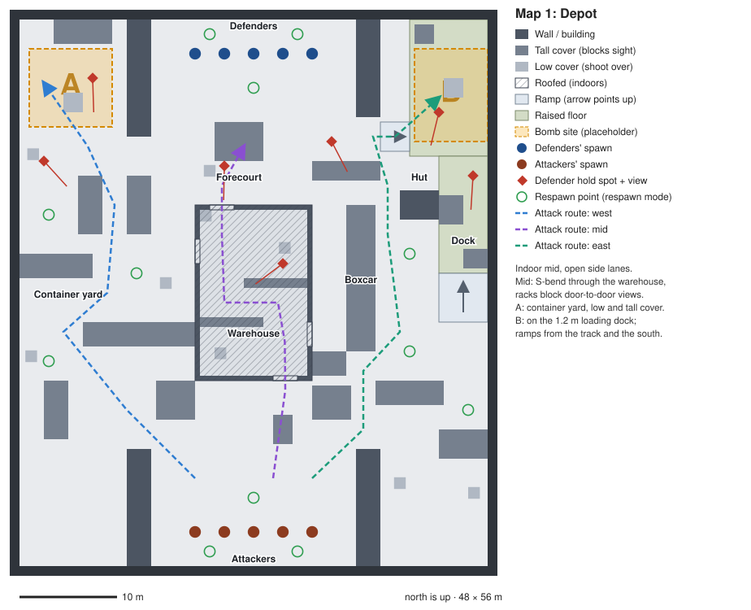
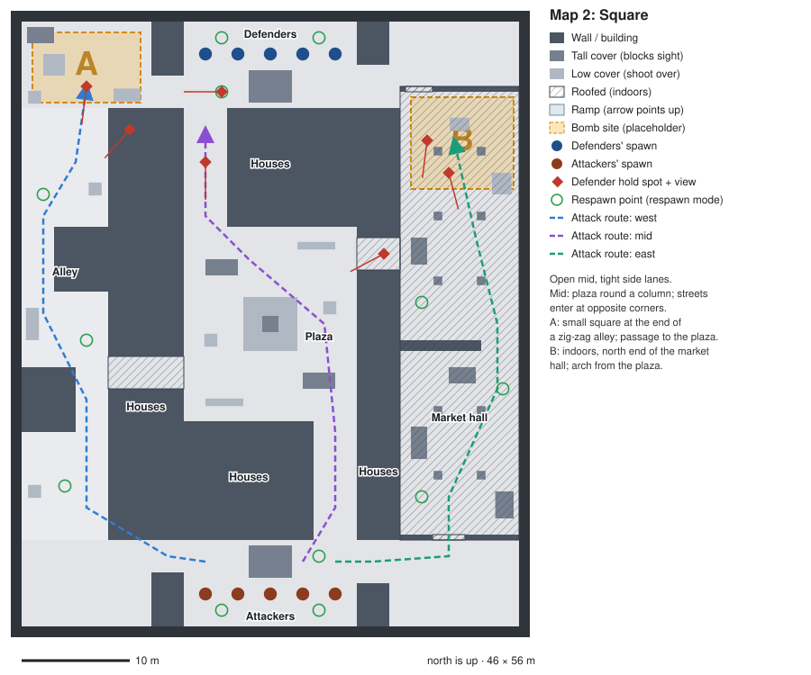
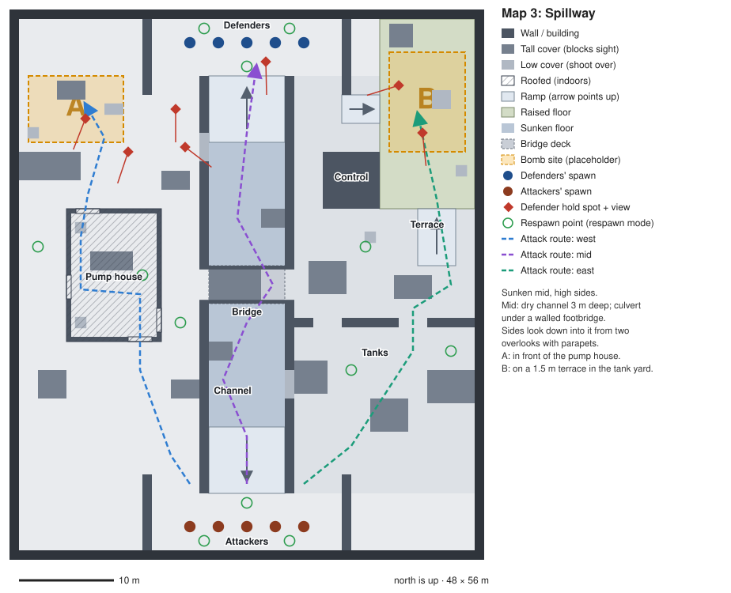

# Chiip — Maps

> Last updated: 2026-10-16
>
> The three quick maps of M8 (D-049), built early so the game has a rotation: **Depot**, **Square** and **Spillway** (placeholder names you picked). They are **blockouts**: complete, playable layouts in plain textures, tested with bots, but not yet detailed and without baked lighting. They play as bomb rounds (D-080). Decisions: D-060–D-063.

## Playing them

- In the game: open the console (the key left of 1) and type `map depot`, `map square` or `map spillway`. `map` alone lists all maps.
- From the terminal: add `-- --map res://maps/depot.tscn` to the run command (see README). Add `--practice` for the bot arena where everyone respawns.
- A match (the default) puts the defenders at the north end and the attackers at the south end; sides swap at half time.

## Rules every map follows

| Rule | Value | Why |
|---|---|---|
| Size | 46–48 m wide, 56 m long inside the outer walls | D-049: 40–60 m across |
| Lanes | Three (west, mid, east), each with its own character, plus connectors between them | D-049 |
| First contact | 5–10 s after the round goes live, measured with bots (median of 4 rounds) | D-049; measured by `tests/maps_test.tscn` (D-061) |
| Sightlines | No spot sees the other spawn; the longest views stay around 40 m or less | D-049: short sightlines (D-061) |
| Spawns | 5 per side, 3 m apart: defenders at the north end (−z, facing south), attackers at the south end (+z, facing north), 49–51 m apart | D-042 |
| Bomb sites | A in the west half, B in the east half, both at the defenders' end | M8 bomb rounds |
| Respawn points | 12, in four zones (north, south, west, east), for the later respawn mode | M8 respawn mode |
| Looks | Minimal and pixelated; see "Look rules" below | D-031, D-063 |

## Look rules

Your direction: *"everything should be minimalistic and pixelated, cs/quake/cod like with the characters like I showed you"* (D-063).

- **Minimal and blocky.** Simple box geometry, clean readable spaces, no clutter, nothing detailed or realistic. Props are plain boxes: crates, containers, stalls, tanks.
- **Few materials: at most 6 main materials per map** for the big surfaces (D-127, since the map kit; before it, 5 in total, D-063). Variants of one material count once: the same ribbed metal in four colours, pale and olive plaster, cobbles and slabs. Details come on top in small doses: trims, signs, props, lamps. All are 64 × 64 retro textures with nearest filtering; the world renders at 480 lines (D-048). How to build with the kit: [MAPPING.md](MAPPING.md).
- **Players stand out.** Characters wear their team colour, painted at runtime: your team blue, enemies red (D-042). So no saturated red or blue on large map surfaces: walls, floors and big props are neutral greys (concrete, plaster, stone, gravel, metal), plus wood as the one warm accent. Muted greens or ochres are fine too. `bricks_red` isn't used: on average it's a muted brown, but 21 % of its pixels are strong reds.
- **Neutral shadows.** The maps' environments light shadows with a neutral grey ambient light instead of the blue sky. With the sky's light, shadowed floors rendered as rgb (43–50, 63–70, 92–100): the same hue as the blue team (215° vs 220°) at 50 % saturation. With grey ambient they render as rgb (63, 64, 65), 3 % saturation, about as bright as before.
- **Cool daylight, no desert:** neutral white sun, grey-blue sky and haze; warm light only from lamps (D-031).
- **Measured, not guessed:** in the screenshots, sunlit and shadowed map surfaces measure at most 5 % saturation; the blue team colour is 64 % and the red 75 %.

## Building rules

What the characters and the bots can handle:

- **No steps.** Characters don't climb steps; every height change is a ramp of 26° or less (the navmesh allows 46°).
- **Doors and gaps at least 2.5 m wide** (bots are 1 m wide on the navmesh) and 3 m tall.
- **Tall cover is 2.2 m or more**, so it hides a standing player (eyes at 1.63 m). **Low cover is 1.2 m or less**, which you can shoot over and jump onto (a jump clears 1.45 m).
- **Raised floors see over walls:** a 1.5 m terrace adds 1.5 m to your eye height, so the walls it overlooks must be taller (Spillway's channel fences are 3 m for that reason).
- **The centre of each bomb site is open floor** (a plant spot), not a crate.

## Markers in each map scene

Every map scene has the same nodes, like the test map:

| Node | Contents | Used by |
|---|---|---|
| `Map` | The built TrenchBroom geometry (`FuncGodotMap`, group `navigation_source`) | Navmesh bake |
| `Navigation` | `NavigationRegion3D`, mesh in `maps/<name>_navmesh.tres` | Bots |
| `Spawns` | `DefendSpawn1–5` (`defend_spawns`), `AttackSpawn1–5` (`attack_spawns`) | Round manager |
| `Tactics` | 7 `Hold…` markers (`hold_points`, facing the angle to hold) and `RouteWest`, `RouteMid`, `RouteEast` (`attack_routes`, waypoints in order) | Bot round plans (D-045) |
| `Objectives` | `BombSiteA`, `BombSiteB`: `Area3D` (group `bomb_sites`) on the triggers layer, watching players and bots, with a floating letter. Saved with `monitoring` off; the bomb switches it on (D-080) | Bomb rounds |
| `Respawns` | `North1–3`, `South1–3`, `West1–3`, `East1–3` (`respawn_points`, also `bot_spawns` and `player_spawns`) | Practice now, respawn mode later |
| `Practice` | 14–16 `Patrol…` markers (`patrol_points`) | Practice bots |
| `Lamps`, `Sun`, `WorldEnvironment` | Lighting and the map's sky and fog | — |
| `Player` | You (stands at the attackers' spawn when no rules move you) | `main.gd` |

## Editing a map

The `.map` files in `maps/` are the source: open them in TrenchBroom (README, "Making maps with TrenchBroom"). Then:

1. Rebuild the scene: `tools/build_maps.gd -- res://maps/depot.tscn` (or *Build Map* on the `Map` node).
2. Bake the navmesh: `tools/bake_navmesh.gd -- res://maps/depot.tscn`.
3. Check it: `tests/maps_test.tscn` (markers, paths, first contact) and `tools/map_report.gd` (sizes, walks, sightlines). If you moved floor or walls, move any marker that now stands inside them.
4. Screenshots: `tools/map_screenshots.gd` renders an overview, both spawns, both sites and the middle of each lane through the real game, with the characters hidden.

The exact commands are in CLAUDE.md. **In TrenchBroom the map is turned:** Godot's x is TrenchBroom's Y and Godot's z is TrenchBroom's X. In TrenchBroom's top view, north (the defenders' end) is on the left and east is at the top.

## Map 1: Depot

A freight yard. **Indoor mid, open side lanes.**

- **Mid:** a brick warehouse with an S-bend inside. Its north and south doors are offset, and two metal racks block the view from one door to the other. Side doors lead west (north half) and east (south half). Warm lamps inside.
- **West, site A:** an open container yard. Overlapping containers (2.6 m) and crates break up the views. A sits in the north-west corner beside a container.
- **East, site B:** a boxcar on the track, a small signal hut and a 1.2 m loading dock along the east wall. B is on the dock, with ramps up from the south end and from the west. Pallet stacks on the dock break the view along it.
- **Spawns:** container stacks (5.2 m) split each spawn yard from the side lanes; wooden stacks in the forecourts give cover and cut the long views across them.
- **Look (6 main materials, dressed with the map kit in M10):** gravel ground, concrete dock and forecourts, grey block yard walls, the light plaster warehouse (windows outside, a ribbed-metal ceiling inside), ribbed containers in green, grey, rust and teal (the same pattern, D-127) and a rusty boxcar, wooden stacks; hazard stripes along the dock's edge. Props and lamps (85 entities in `depot.map`): pendant lamps in the warehouse, floodlights high on the yard walls, a lantern and a door on the signal hut, the boxcar's siding (railway track), signs to A and B on the warehouse and above each site, pipes and cabinets along the walls, a van and a forklift in the dead-end corners behind the spawn stacks, and floor clutter without collision (grass, pallets, debris). Clear noon (`clear_noon.tres`: today's cool-daylight sky with neutral ambient light), sun 38° high.

## Map 2: Square

An old-town square. **Open mid, tight side lanes.**

- **Mid:** an open plaza around a 5.5 m stone column on a fountain basin, with two market stalls and planters. The streets from the spawns enter it at opposite corners.
- **West, site A:** a narrow zig-zag alley between houses. The two houses that jut into it overlap, so no straight line runs through. A is a small square with a well at the alley's north end. A covered passage through the houses connects the alley to the plaza.
- **East, site B:** a long market hall with a roof, stone pillars and stalls. A wall with a gap on the east side splits it in two; B is **indoors** at the north end. An arch through the houses connects the plaza to the hall's north half. The hall's doors are offset from the gap, so you can't see down the whole hall.
- **Spawns:** a kiosk in front of each spawn breaks the views across the spawn yards.
- **Look (4 materials):** stone paving, pale plaster houses, stone corner houses and pillars, a gravel alley, wooden stalls, kiosks and hall roof. A low morning sun (24° high) with long shadows (`clear_morning.tres`: a slightly paler sky, a little more haze, neutral ambient light).

## Map 3: Spillway

A dry concrete water works. **Sunken mid, high sides.**

- **Mid:** a dry channel 3 m deep, with ramps down at both ends and 3 m fences along its edges. A walled footbridge crosses it in the middle; under the bridge the channel narrows to a 2.5 m culvert, and concrete blocks on either side of the bridge stop anyone seeing straight through. Two overlooks with low parapets let the sides shoot down into the channel.
- **West, site A:** a pump house you can go through (offset doors with a pump in between) or around (two corridors with overlapping blockers). A is in front of its north door.
- **East, site B:** a tank yard split by a pipe wall with two gaps, each with a tank right behind it, so no view runs through. B is on a 1.5 m terrace with ramps up from the south and the west; a control house blocks the view from the yard up onto the terrace.
- **Look (5 materials):** concrete, plaster, metal, gravel and a few wooden crates under an overcast sky (`overcast.tres`: grey sky, neutral ambient light, more fog), a weak high sun.

## Measurements

From `tests/maps_test.tscn` (seeded bots-only 3v3, 4 rounds, timed from the round going live; since D-081 they are bomb rounds) and `tools/map_report.gd`. Walking distances follow the navmesh from the middle spawn marker.

| | Depot | Square | Spillway |
|---|---|---|---|
| First contact, each round (median), bomb rounds (D-081) | 5.4, 5.4, 5.5, 6.0 s (5.4 s) | 6.0, 6.2, 7.2, 9.1 s (6.7 s) | 5.5, 5.6, 6.0, 6.7 s (5.8 s) |
| Round length (bomb rounds; before the bomb all ended by elimination in 9–23 s) | 31–43 s | 19–50 s | 15–31 s |
| Spawn to spawn, walking (straight line) | 52 m (49 m) | 62 m (50 m) | 52 m (51 m) |
| Attackers to A / B | 57 m / 52 m | 65 m / 54 m | 51 m / 53 m |
| Defenders to A / B | 25 m / 23 m | 18 m / 20 m | 20 m / 21 m |
| Routes west / mid / east | 58 / 49 / 68 m | 61 / 51 / 59 m | 57 / 53 / 55 m |
| Longest sightline | 44 m | 35 m | 38 m |
| Spot pairs that see each other over 30 m / 40 m | 560 / 3 | 79 / 0 | 375 / 0 |
| Spawn-to-spawn views | 0 | 0 | 0 |
| Bomb rounds with bots (D-081): plants in 4 rounds, how they ended | 4 plants: 4 defused | 4 plants: 2 defused, 2 elimination | 3 plants: 1 defused, 2 elimination; 1 round decided before a plant |

At 5.5 m/s (rifle in hand) a 52 m walk takes about 9.5 s. Contact comes earlier because defenders move up to their hold spots and toward the sound of footsteps.

## How the layouts were tuned

The blockouts were generated once from a small layout script (outside the repository, so the `.map` files are the only source), then tuned in three rounds with bots and the sightline report:

1. **First build:** first contact Depot 4.1–5.1 s, Square 6.1–7.6 s, Spillway 3.4–5.8 s. Depot and Spillway were too quick: defenders who heard footsteps met attackers early, and on Spillway an attacker in the tank yard could see a defender on the B terrace 30 m away. Both maps got 2 m deeper spawn yards at each end (56 m long), Depot's corridor between the warehouse and the boxcar was closed to the south, and Spillway got a control house in front of the terrace.
2. **Sightlines:** the report found 45–60 m diagonals slipping between obstacles that had only been placed against straight north–south views. Obstacles now overlap (the alley houses, the containers, the pump-house corridor blockers), doors are offset (pump house, market hall, the passage and arch on Square), there are "gates" with something right behind them (Spillway's pipe wall), and kiosks and wooden stacks break the views across the spawn yards and forecourts.
3. **Bugs found on the way:** Depot's west ramp onto the dock started against a container stack, so it couldn't be walked onto (bots took a 43 m detour); the ramp and stack moved. Spillway's 1.5 m terrace saw over the 2.4 m channel fences, which are now 3 m.

## Next for these maps

- **Your playtest:** how they feel, what to change, and the final names.
- **Detail pass:** done with the map kit in M10 (D-127, D-128): textures, props, signs and lamps, without moving walls or cover; the measurements below were taken again after dressing. Lighting stays real-time (D-085; comparison: [maps/lighting_depot.jpg](maps/lighting_depot.jpg)).
- **Bomb logic:** done (D-080): plant anywhere on the floor inside a site's area.
- **Respawn mode (M8):** pick a `respawn_points` marker away from enemies.
